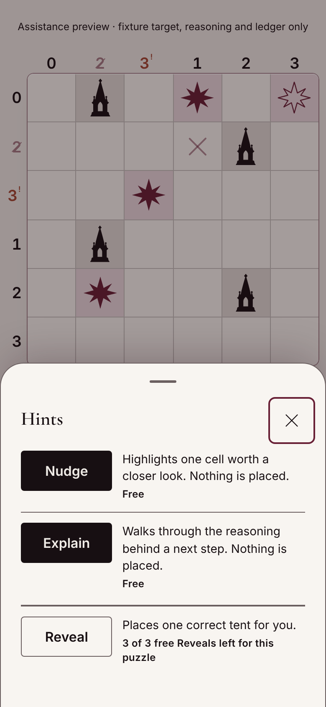
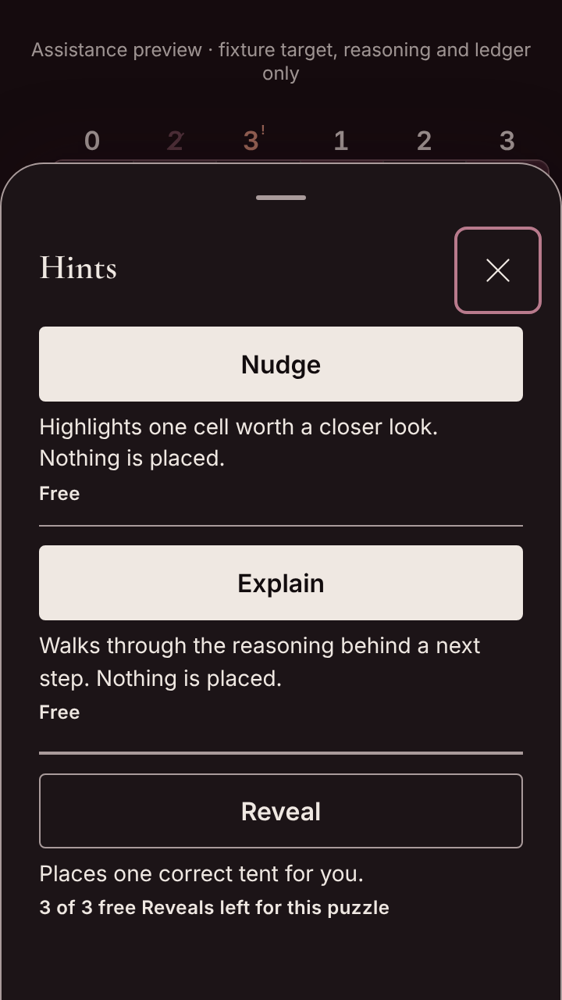
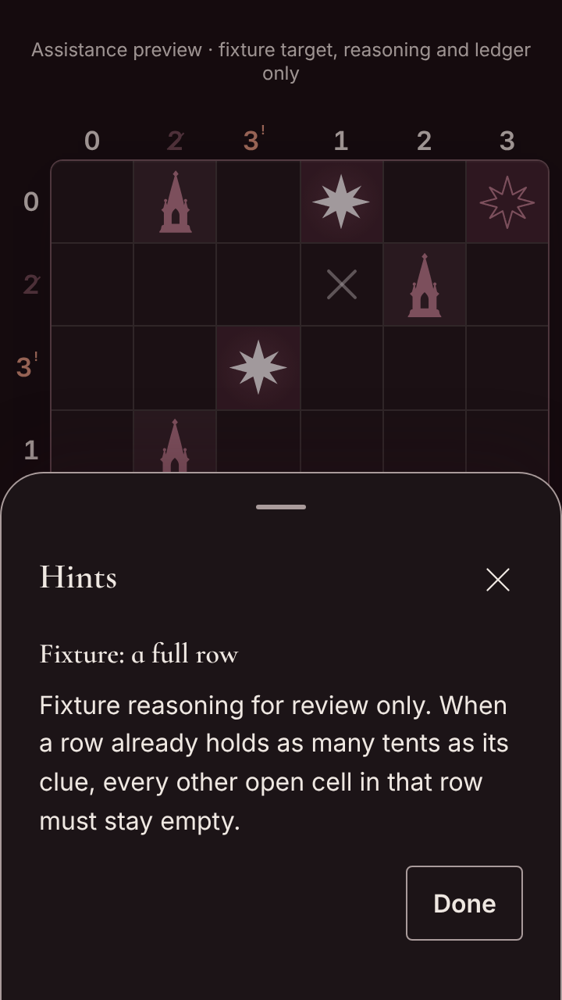
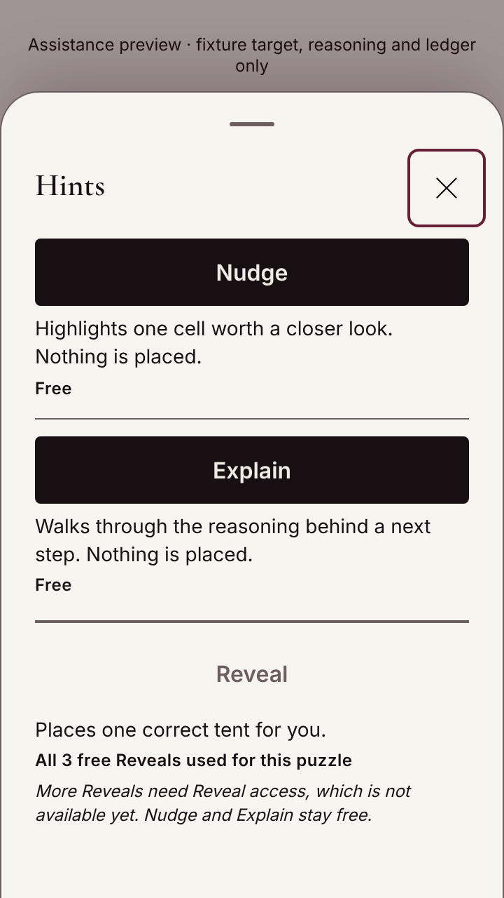
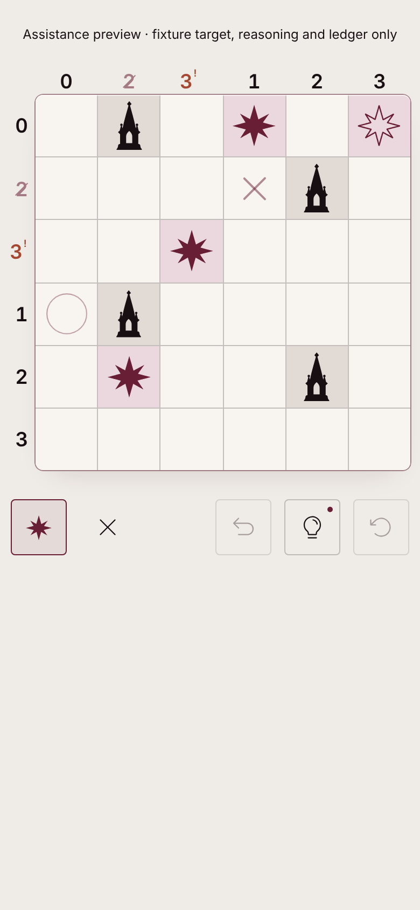
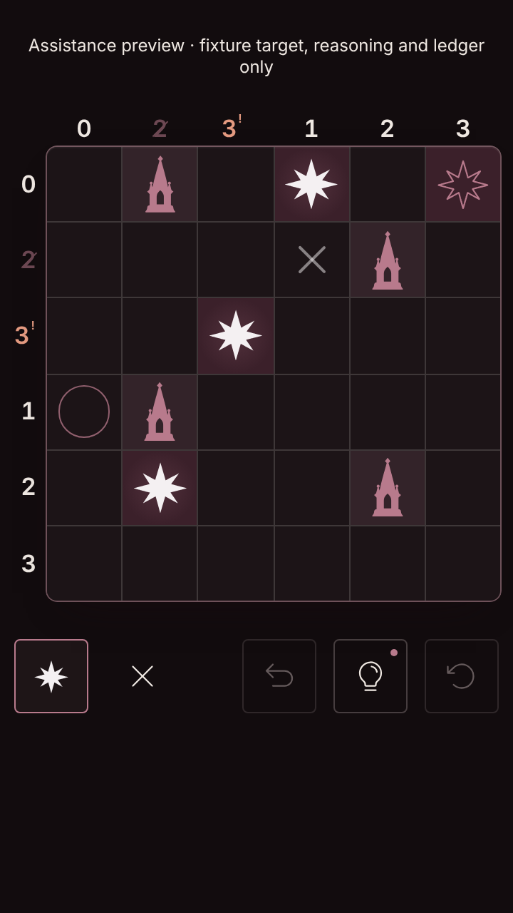

# Feature Expansion Assistance review

Library issue #67 / Linear UICOMP-5. Previews: **Projects / Grim & Glimmer / Feature Expansion / Assistance**. API and behavior: [assistance-presentation.md](../assistance-presentation.md).

| Sheet · 390px light           | Sheet · 360px dark           |
| ----------------------------- | ---------------------------- |
|  |  |

| Explain · 360px dark             | Reveal exhausted · 360px light        |
| -------------------------------- | ------------------------------------- |
|  |  |

| Nudge cue (pulse) · 390px light | Nudge cue (reduced motion) · 360px dark |
| ------------------------------- | --------------------------------------- |
|        |     |

Also captured: `sheet-light-360`, `sheet-dark-390`, `cue-dark-390`, `failure-dark-390`.

Browser verification (Chromium/Playwright against the production Storybook build, 360×640 and 390×844, light/dark): no horizontal overflow; every visible panel button is at least 44×44px; axe WCAG 2 A/AA and 2.1 AA found no violations in the open sheet or story root. The cue runs exactly one shared pulse animation normally and none under `prefers-reduced-motion`, resting at 0.75 opacity. In the Explain view only the Done button is rendered (the tier list is hidden in layout, not just in the DOM). Results: `browser-results.json`. This is scoped automated evidence, not an accessibility certification.

All 24 Assistance stories render without console errors; the play functions for Nudge (no confirmation, no mark, accessible description and announcement), Explain (focus handoff, no lesson link without a destination, lesson link with one), Reveal lifecycle, Reveal failure and Reveal exhausted (no purchase text) pass.

**Pending:** physical Android cue visibility, screen-reader (TalkBack) listening, and an app consuming the API (gothic-cozy-puzzles#74). The approved hint-circle is unchanged.
