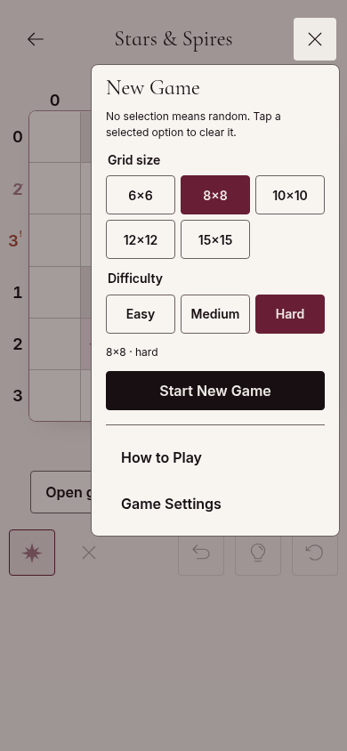
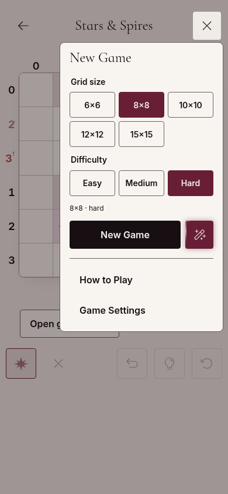
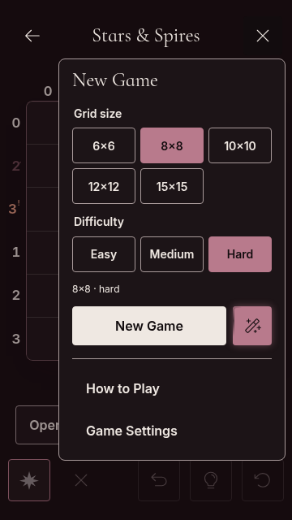

# Feature Expansion Game Menu review

Owner revision 2026-11-13, library #66 / PR #71. Before images are the first PR revision `8d7538f` (optional selections); after images implement required selections and a separate Surprise Me action. Existing V4 reference stories remain unchanged; this round is grouped under **Projects / Grim & Glimmer / Feature Expansion / GameMenu**.

| Before: 390px light             | After: 390px light            |
| ------------------------------- | ----------------------------- |
|  |  |

| Before: 360px dark             | After: 360px dark            |
| ------------------------------ | ---------------------------- |
|  |  |

The body paragraph above Grid size is removed. Required native radio groups retain selected size/difficulty. New Game occupies 80% of the action tracks and the Phosphor magic-wand Surprise Me button occupies 20% (after the gap). Its independent random request never replaces committed preferences. The button and rotating edge glow use the current mode's accent. Reduced motion and Animations OFF retain a static accent treatment.

[Glow recording (dark mode)](surprise-glow.webm). The animation rotates only the decorative edge, not the wand.

The shared menu retains loading/unavailable states, pending-versus-committed rollback, focus return, Back, How to Play and Game Settings. Global preferences stay in main Settings. App integration and real selection remain gothic-cozy-puzzles#38; see the [API handoff](../game-menu-new-game.md).

Browser verification: Chromium/Playwright tested 320×568, 360×640 and 390×844, light/dark, reduced/normal motion (12 combinations). It checked required selection, native arrow keys and Tab order, independent Surprise Me, retained committed preferences, exact 4:1 action tracks, theme accent, changing glow transforms, reduced-motion suppression, 44×44px targets, panel bounds and no horizontal overflow. Axe WCAG 2 A/AA and 2.1 AA checks found no violations in the tested panel. This is scoped automated evidence, not a complete accessibility certification.

Seven additional stories were exercised: loading, unavailable, selected-pool unavailable with random still available, tall content, explicit reduced motion, open/close/reopen, and Start/Surprise interaction. `browser-results.json` contains the measured geometry and accessibility results.

Run `NPM_CONFIG_CACHE=/workspace/.npm-cache npm run check` for lint, formatting, types, all unit/integration tests, library build, publint, packed-consumer NodeNext/Bundler and theme checks, and production Storybook. Validation counts and final results are recorded in the PR description.

Physical Android/WebView and an app consuming this revised API remain unverified. No app code, saves, game logic or artwork assets changed.
