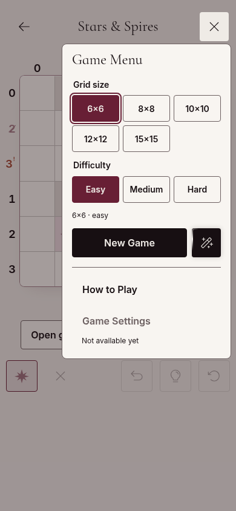
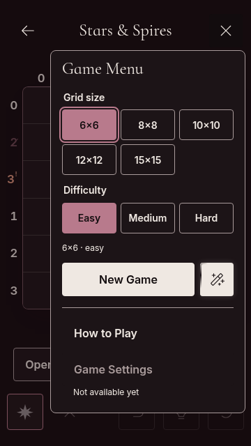

# Unavailable Game Settings — app #38 prerequisite

The owner approved keeping Game Settings visible but disabled, with **Not available yet** help, until puzzle-specific settings exist in app #86. Global Settings remains accessible from Home.

The supported `createGameMenuContent` API now makes `onGameSettings` optional. Omitting it disables the native button and renders the visible default help. `gameSettingsUnavailableMessage` optionally supplies plain-text help and disables the action even if a callback exists. The button's `aria-describedby` links to that help; disabled native controls are excluded from the existing overlay's Tab cycle. Existing consumers with callbacks and no unavailable reason retain the enabled behavior.

| 390px light                         | 360px dark                        |
| ----------------------------------- | --------------------------------- |
|  |  |

The story is grouped under Feature Expansion / GameMenu / Game Settings Unavailable and exercises the real exported API. No app-only button patch or global Settings substitution is needed.

Validation: full `NPM_CONFIG_CACHE=/workspace/.npm-cache npm run check` passed: lint, formatting, types, 651 tests across 54 files, library build, publint, packed-consumer NodeNext/Bundler and theme checks, and production Storybook (375 entries). Browser checks passed eight combinations of 360×640 and 390×844, light/dark, reduced/normal motion, checking the disabled native action, visible accessible explanation, no activation, focus/Tab/Escape and horizontal bounds. Axe WCAG 2 A/AA and 2.1 AA found no violations within the tested panel. See `results.json`.

App #38 integration follows review/merge of this public API, per the cross-repository delivery gate. The app's preference and random-selection foundation is already implemented independently on its feature branch. Physical Android and the consuming app's full-flow verification remain pending.
