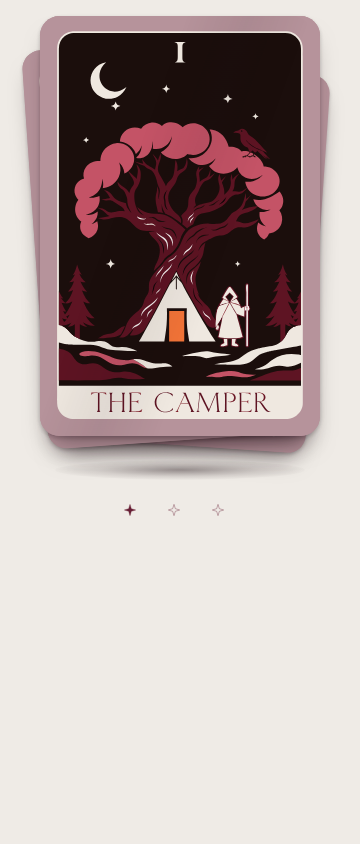
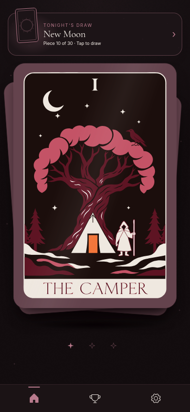

# Tarot gleam clipping — library #57

Baseline: merged main `6025ea4`. The translating sheen was a child of an unclipped `.gg-v4-deck-shell`; clipping the inner artwork or the sheen's own contents did not constrain the moving element. The fix adds `overflow: hidden` to the already-rounded shell. The shell continues painting its own outer shadow. Artwork, motion keyframes/timing, hit target, inset focus styling and layout are unchanged.

| Before: Stack, light, 360px           | After                               |
| ------------------------------------- | ----------------------------------- |
|  |  |

| Before: StackHome, dark, 390px           | After                                  |
| ---------------------------------------- | -------------------------------------- |
|  |  |

## Rendered regression check

Chromium/Playwright exercised before/after × Stack/StackHome × 360/390px × light/dark: 16 scenarios. The real cold-entry sheen Web Animation was paused at 150, 300 and 750ms into its 900ms sweep, after the existing 700ms delay (48 sampled frames). Other page motion was frozen to isolate the sheen. At each phase, compare the rendered image with the same paused sheen hidden, measuring changes outside the top card's rounded silhouette.

The comparison uses a two-pixel boundary guard for antialiasing and a two-channel-level difference threshold. Baseline spill reached 14,788 changed pixels outside the card; patched spill was zero in every sampled frame. The sheen remained visible inside the card in every scenario. See `results.json`, which also confirms unchanged computed card shadows, exact sheen keyframes/delay/duration, inset 2px focus outline at -4px offset, keyboard focus return and 2→3→1 card cycling.

OS reduced motion and the explicit ReducedMotion story create no sheen animation. A separate direct library consumer using `animations: false` creates zero Web Animations on mount and cycling in both themes (`animations-off.json`). Native center-click routing and ≥44px hit-target bounds were checked separately for all eight patched Stack/Home/theme/width combinations (`hit-targets.json`).

## Checks and handoff

`NPM_CONFIG_CACHE=/workspace/.npm-cache npm run check` passed: lint, formatting, typecheck, 649 tests across 54 files, library build, publint, packed-consumer NodeNext/Bundler and theme checks, and production Storybook (374 entries). No implementation-mirroring unit test was added for this CSS rule; rendered before/after measurements verify the bug directly.

Physical Android/WebView review remains pending. The app's temporary scoped clipping rule can be removed only after it adopts the reviewed library merge; this library-only PR does not change the app dependency or its CSS.
